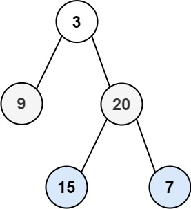

# 103. Binary Tree Zigzag Level Order Traversal

## Problem

<span style="color: #f59e0b;"><strong>Medium</strong></span>

Given the root of a binary tree, return the zigzag level order traversal of its nodes' values. (i.e., from left to right, then right to left for the next level and alternate between).

### Example 1



```text
Input: root = [3,9,20,null,null,15,7]
Output: [[3],[20,9],[15,7]]
Explanation: The traversal alternates direction at each level: [3] from left to right, [20,9] from right to left, and [15,7] from left to right.
```

### Example 2

```text
Input: root = [1]
Output: [[1]]
Explanation: The tree has one level, so the traversal contains only [1].
```

### Example 3

```text
Input: root = []
Output: []
Explanation: The tree is empty, so there are no levels to traverse.
```

Constraints:

- The number of nodes in the tree is in the range [0, 2000].
- -100 <= Node.val <= 100

<https://leetcode.com/problems/binary-tree-zigzag-level-order-traversal/>

## Answer

### 解題思路

使用廣度優先搜尋（BFS）搭配佇列，依層走訪二元樹。每一輪開始時先固定佇列大小，這就是目前層的節點數；處理這些節點時，一律依左子節點、右子節點的順序將孩子加入佇列，確保下一輪仍按由左至右的順序取出。

目前層的節點值先照佇列順序放入串列。若該層方向是由右至左，再反轉這個串列；每完成一層就切換方向。如此只改變該層的輸出順序，不會影響後續各層的 BFS 走訪。若 `root` 為 `null`，直接回傳空結果。

```java
import java.util.ArrayDeque;
import java.util.ArrayList;
import java.util.Collections;
import java.util.List;
import java.util.Queue;

class Solution {
    public List<List<Integer>> zigzagLevelOrder(TreeNode root) {
        List<List<Integer>> result = new ArrayList<>();
        if (root == null) {
            return result;
        }

        Queue<TreeNode> queue = new ArrayDeque<>();
        // 佇列保存尚未處理的節點；根節點是第一層唯一的候選。
        queue.offer(root);
        boolean leftToRight = true;

        while (!queue.isEmpty()) {
            // 固定本層節點數，避免稍後加入的下一層節點混入本輪。
            int levelSize = queue.size();
            List<Integer> currentLevelValues = new ArrayList<>(levelSize);

            for (int index = 0; index < levelSize; index++) {
                TreeNode currentNode = queue.poll();
                currentLevelValues.add(currentNode.val);

                // 每層都按左、右順序擴展，維持佇列的 BFS 層序。
                if (currentNode.left != null) {
                    queue.offer(currentNode.left);
                }
                if (currentNode.right != null) {
                    queue.offer(currentNode.right);
                }
            }

            // 只反轉目前層的結果，不改變佇列中下一層的走訪順序。
            if (!leftToRight) {
                Collections.reverse(currentLevelValues);
            }
            result.add(currentLevelValues);
            leftToRight = !leftToRight;
        }

        return result;
    }
}
```

### 說明

1. `levelSize` 在每層開始時固定，因此該輪只會處理原本位於該層的節點。
2. 子節點始終依左、右順序加入佇列；方向交替只透過反轉本層串列實現，不影響下一層的候選順序。
3. 空樹會直接回傳空串列；只有一層時不需反轉，結果仍是根節點的值。
4. 設 `n` 為二元樹的節點數。每個節點恰好處理一次，時間複雜度為 $O(n)$。佇列最多保存一層的節點，額外空間為 $O(w)$（`w` 為樹的最大寬度）；計入存放所有答案的結果串列後，總空間複雜度為 $O(n)$。
