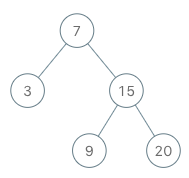

# 173. Binary Search Tree Iterator

## Problem

<!-- markdownlint-disable MD033 -->
<span style="color: #f59e0b;"><strong>Medium</strong></span>
<!-- markdownlint-enable MD033 -->

Implement the `BSTIterator` class that represents an iterator over the in-order traversal of a binary search tree (BST):

- `BSTIterator(TreeNode root)` initializes an object of the `BSTIterator` class. The root of the BST is given as part of the constructor. The pointer should be initialized to a non-existent number smaller than any element in the BST.
- `boolean hasNext()` returns `true` if there exists a number in the traversal to the right of the pointer; otherwise, it returns `false`.
- `int next()` moves the pointer to the right, then returns the number at the pointer.

Notice that by initializing the pointer to a non-existent smallest number, the first call to `next()` will return the smallest element in the BST.

You may assume that `next()` calls will always be valid. That is, there will be at least a next number in the in-order traversal when `next()` is called.

### Example 1



```text
Input: ["BSTIterator", "next", "next", "hasNext", "next", "hasNext", "next", "hasNext", "next", "hasNext"]
[[[7, 3, 15, null, null, 9, 20]], [], [], [], [], [], [], [], [], []]
Output: [null, 3, 7, true, 9, true, 15, true, 20, false]
Explanation:
BSTIterator bSTIterator = new BSTIterator([7, 3, 15, null, null, 9, 20]);
bSTIterator.next();    // return 3
bSTIterator.next();    // return 7
bSTIterator.hasNext(); // return True
bSTIterator.next();    // return 9
bSTIterator.hasNext(); // return True
bSTIterator.next();    // return 15
bSTIterator.hasNext(); // return True
bSTIterator.next();    // return 20
bSTIterator.hasNext(); // return False
```

### Constraints

- The number of nodes in the tree is in the range [1, 10^5].
- 0 <= Node.val <= 10^6
- At most 10^5 calls will be made to `hasNext` and `next`.

### Follow-up

Could you implement `next()` and `hasNext()` to run in average O(1) time and use O(h) memory, where h is the height of the tree?

[LeetCode 173. Binary Search Tree Iterator](https://leetcode.com/problems/binary-search-tree-iterator/)

## Answer

### 解題思路

二元搜尋樹的 in-order 走訪順序是「左、中、右」。這個迭代器用堆疊保存尚未處理的節點，模擬遞迴走訪時暫存的祖先節點。

初始化時，從根節點沿左子樹一路往下，將經過的節點依序推入堆疊。這會先準備「左」側；堆疊頂端是最左邊、下一個應處理的節點。呼叫 `next()` 時，彈出並回傳堆疊頂端，完成該節點的「中」。若它有右子樹，就轉入「右」側，並把右子樹一路向左的路徑推入堆疊，讓右子樹 in-order 順序最前面的節點成為下一個候選。因此，彈出節點之後再處理它的右子樹，正好維持「左、中、右」的順序。

`hasNext()` 只需檢查堆疊是否為空。每個節點最多推入及彈出一次，因此整段走訪的總工作量為 $O(n)$，平均每次 `next()` 為 $O(1)$；單次 `next()` 在需要推入一段左側路徑時可能花費 $O(h)$。

每個節點最多推入及取出堆疊一次，因此整段走訪的總工作量為 $O(n)$，平均每次 `next()` 為 $O(1)$；單次 `next()` 在需要推入一段左側路徑時可能花費 $O(h)$。

```java
import java.util.ArrayDeque;
import java.util.Deque;

class BSTIterator {
    private final Deque<TreeNode> nodeStack;

    public BSTIterator(TreeNode root) {
        nodeStack = new ArrayDeque<>();
        // 先準備 in-order 的「左」側：堆疊頂端會是最左邊、最先走訪的節點。
        pushLeftBranch(root);
    }

    public int next() {
        // 彈出下一個節點，完成 in-order 順序中的「中」。
        TreeNode nextNode = nodeStack.pop();

        // 接著處理「右」子樹；先壓入其左側路徑，維持左、中、右順序。
        pushLeftBranch(nextNode.right);
        return nextNode.val;
    }

    public boolean hasNext() {
        // 堆疊非空代表仍有尚未回傳的節點。
        return !nodeStack.isEmpty();
    }

    private void pushLeftBranch(TreeNode node) {
        // 沿左子樹前進並保存祖先，讓最左側節點成為下一個候選。
        while (node != null) {
            nodeStack.push(node);
            node = node.left;
        }
    }
}
```

### 邊界條件

- 樹為空時，初始化不會推入任何節點，`hasNext()` 會回傳 `false`。題目給定的測試至少有一個節點。
- 只有一個節點時，初始化後該節點位於堆疊頂端；取出後堆疊為空。
- 節點沒有右子樹時，不需新增候選節點，堆疊中保留的祖先會接續提供下一個節點。
- 題目保證呼叫 `next()` 時一定有下一個節點，因此不需在 `next()` 中處理空堆疊。

### 複雜度分析

令 `n` 為樹中的節點數，`h` 為樹高。

- 建構時間：$O(h)$，最多將根節點到最左側葉節點的路徑推入堆疊。
- `next()`：攤銷時間為 $O(1)$；一次完整 in-order 走訪中，每個節點只會推入及取出一次。單次呼叫最差為 $O(h)$。
- `hasNext()`：$O(1)$，只檢查堆疊是否為空。
- 空間複雜度：$O(h)$，堆疊最多保存高度數量級的節點。