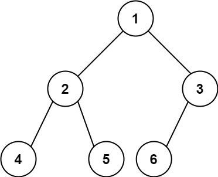

# 222. Count Complete Tree Nodes

## Problem

<!-- markdownlint-disable MD033 -->
<span style="color: #f59e0b;"><strong>Medium</strong></span>
<!-- markdownlint-enable MD033 -->

Given the root of a complete binary tree, return the number of the nodes in the tree.

According to Wikipedia, every level, except possibly the last, is completely filled in a complete binary tree, and all nodes in the last level are as far left as possible. It can have between 1 and 2^h nodes inclusive at the last level h.

Design an algorithm that runs in less than O(n) time complexity.

### Example 1



```text
Input: root = [1,2,3,4,5,6]
Output: 6
```

### Example 2

```text
Input: root = []
Output: 0
```

### Example 3

```text
Input: root = [1]
Output: 1
```

### Constraints

- The number of nodes in the tree is in the range [0, 5 * 10^4].
- 0 <= Node.val <= 5 * 10^4
- The tree is guaranteed to be complete.

[LeetCode 222. Count Complete Tree Nodes](https://leetcode.com/problems/count-complete-tree-nodes/description/?envType=study-plan-v2&envId=top-interview-150)

## Answer

### 解題思路

完全二元樹的最後一層由左向右填入，因此在同一節點的左右子樹中，至少有一棵會是完美二元樹（每一層都填滿）。只要比較左右子樹最左側路徑的高度，就能判斷哪一側是完美二元樹，並直接計算該側的節點數，只對另一側遞迴。

### 完美二元樹的節點數

若整棵完美二元樹有 `H` 層，每一層的節點數依序為 $1, 2, 4, \ldots, 2^{H-1}$，所以總節點數是：

$$1 + 2 + 4 + \cdots + 2^{H-1} = 2^H - 1$$

程式中的 `leftHeight` 是「左子樹的層數」，不包含目前節點。若這個左子樹是完美二元樹，有 `k` 層，它本身有 $2^k - 1$ 個節點；加上目前節點後，這一部分共 $1 + (2^k - 1) = 2^k$ 個節點，因此程式可以用 `(1 << leftHeight)` 一次算出。右子樹尚未計入，會由遞迴接著計算。

例如整棵樹有 3 層時，總數是 $2^3 - 1 = 7$。根節點的左子樹有 2 層、共 3 個節點，所以程式先算根節點加左子樹：$1 + 3 = 4$（也就是 $2^2$）；再遞迴數右子樹的 3 個節點，最後得到 $4 + 3 = 7$。

### 為什麼比較高度能找出完美子樹？

這個判斷利用完全二元樹「最後一層由左到右填入」的規則。在完全二元樹中，`leftHeight` 不會小於 `rightHeight`：左右高度不同時，左邊一定比較高。

- **左右高度相同**：右子樹也有節點延伸到同一層。既然最後一層由左到右填入，左子樹的該層就一定已填滿，因此左子樹是完美二元樹。程式直接計算「目前節點 + 左子樹」的數量，也就是 $2^{leftHeight}$，再遞迴計算右子樹。
- **左邊高度較高**：最後一層還在左子樹，尚未延伸到右子樹，所以右子樹各層都已填滿，是完美二元樹。程式直接計算「目前節點 + 右子樹」的數量，也就是 $2^{rightHeight}$，再遞迴計算左子樹。

左右高度相同的例子：

```text
       1
      ╱ ╲
     2   3
    ╱ ╲ ╱
   4  5 6
```

根節點的左右子樹高度都是 `2`，所以左子樹（節點 `2、4、5`）是完美二元樹。先算根節點加左子樹共 `4` 個，再遞迴數右子樹的 `2` 個，合計 `6`。

左邊高度較高的例子：

```text
    1
   ╱ ╲
  2   3
 ╱
4
```

根節點的左子樹高度是 `2`、右子樹高度是 `1`。最後一層還在左邊，因此右子樹（只有節點 `3`）是完美二元樹。先算根節點加右子樹共 `2` 個，再遞迴數左子樹的 `2` 個，合計 `4`。

每次遞迴都只進入一棵子樹。高度計算需沿左側路徑走訪，最多遞迴 $O(\log n)$ 層，每層計算高度需 $O(\log n)$，因此整體時間複雜度為 $O(\log^2 n)$。

```java
class Solution {
    public int countNodes(TreeNode root) {
        if (root == null) {
            return 0;
        }

        // 比較左右子樹的最左側路徑，判斷哪一側是完美二元樹。
        int leftHeight = leftmostHeight(root.left);
        int rightHeight = leftmostHeight(root.right);

        if (leftHeight == rightHeight) {
            // 左子樹已填滿，加上目前節點共 2 的 leftHeight 次方個，再計算右子樹。
            return (1 << leftHeight) + countNodes(root.right);
        }

        // 右子樹已填滿，加上目前節點共 2 的 rightHeight 次方個，再計算左子樹。
        return (1 << rightHeight) + countNodes(root.left);
    }

    private int leftmostHeight(TreeNode node) {
        int height = 0;

        // 沿最左側路徑往下，計算從此節點開始的層數。
        while (node != null) {
            height++;
            node = node.left;
        }

        return height;
    }
}
```

### 邊界條件

- 空樹直接回傳 `0`。
- 單一節點的左右子樹高度皆為 `0`，公式會回傳 `1`。
- 完美二元樹會在每層直接計算已填滿子樹的節點數，不必逐一走訪節點。

### 複雜度分析

令 `n` 為節點數，`h` 為樹高。

- 時間複雜度：$O(\log^2 n)$。遞迴深度為 $O(\log n)$，每層以 $O(\log n)$ 計算子樹高度。
- 空間複雜度：$O(\log n)$，來自遞迴呼叫堆疊。
