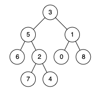

# 236. Lowest Common Ancestor of a Binary Tree

## Problem

<span style="color: #f59e0b;"><strong>Medium</strong></span>

Given a binary tree, find the lowest common ancestor (LCA) of two given nodes in the tree.

According to the definition of LCA on Wikipedia: “The lowest common ancestor is defined between two nodes `p` and `q` as the lowest node in `T` that has both `p` and `q` as descendants (where we allow a node to be a descendant of itself).”

### Example 1



```text
Input: root = [3,5,1,6,2,0,8,null,null,7,4], p = 5, q = 1
Output: 3
Explanation: The LCA of nodes 5 and 1 is 3.
```

### Example 2


```text
Input: root = [3,5,1,6,2,0,8,null,null,7,4], p = 5, q = 4
Output: 5
Explanation: The LCA of nodes 5 and 4 is 5, since a node can be a descendant of itself according to the LCA definition.
```

### Example 3

```text
Input: root = [1,2], p = 1, q = 2
Output: 1
```

### Constraints

- The number of nodes in the tree is in the range `[2, 10^5]`.
- `-10^9 <= Node.val <= 10^9`
- All `Node.val` are unique.
- `p != q`
- `p` and `q` will exist in the tree.

[LeetCode Problem](https://leetcode.com/problems/lowest-common-ancestor-of-a-binary-tree/)

## Answer

### 解題思路

使用迭代 DFS 建立節點到父節點的對照表，再找出 `p` 與 `q` 祖先路徑的第一個交會點。採用迭代方式可避免樹高很大時遞迴呼叫堆疊過深。

1. 從根節點開始走訪，記錄每個節點的父節點；直到 `p`、`q` 都已出現在對照表中。
2. 從 `p` 沿父節點一路往上，將所有祖先（包含 `p`）存入集合。
3. 從 `q` 開始往上走，第一個出現在集合中的節點就是最低共同祖先，因為這是 `q` 的祖先路徑上最先遇到的 `p` 祖先。

`TreeNode` 使用物件參考作為 HashMap 與 HashSet 的鍵，因此比對的是題目指定的節點，而不是只比對節點值。題目保證 `p`、`q` 都存在於樹中。

```java
import java.util.ArrayDeque;
import java.util.Deque;
import java.util.HashMap;
import java.util.HashSet;
import java.util.Map;
import java.util.Set;

class Solution {
    public TreeNode lowestCommonAncestor(TreeNode root, TreeNode p, TreeNode q) {
        if (root == null) {
            return null;
        }

        Map<TreeNode, TreeNode> parent = new HashMap<>();
        Deque<TreeNode> stack = new ArrayDeque<>();
        parent.put(root, null);
        stack.push(root);

        // 以堆疊迭代走訪，並記錄每個已發現節點的父節點。
        while (!parent.containsKey(p) || !parent.containsKey(q)) {
            TreeNode current = stack.pop();

            if (current.left != null) {
                parent.put(current.left, current);
                stack.push(current.left);
            }
            if (current.right != null) {
                parent.put(current.right, current);
                stack.push(current.right);
            }
        }

        // p 到根節點的路徑包含 p 本身，先全部存入集合。
        Set<TreeNode> ancestorsOfP = new HashSet<>();
        while (p != null) {
            ancestorsOfP.add(p);
            p = parent.get(p);
        }

        // q 向根回溯時，第一個命中 p 祖先集合的節點即為最近交會點。
        while (!ancestorsOfP.contains(q)) {
            q = parent.get(q);
        }
        return q;
    }
}
```

### 複雜度分析

- 時間複雜度：`O(n)`，最差情況需走訪整棵樹，並各自回溯 `p`、`q` 的祖先路徑；每個節點至多被走訪一次。
- 空間複雜度：`O(n)`，父節點對照表與祖先集合最多保存 `n` 個節點，DFS 堆疊也最多保存 `O(n)` 個節點。

其中 `n` 是二元樹的節點數。
