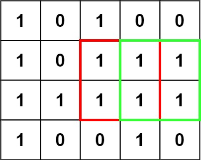
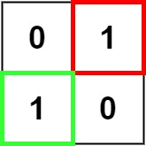

# 221. Maximal Square

## Problem

<span style="color: #f59e0b;"><strong>Medium</strong></span>

Given an m x n binary matrix filled with 0's and 1's, find the largest square containing only 1's and return its area.

### Example 1



```text
Input: matrix = [["1","0","1","0","0"],["1","0","1","1","1"],["1","1","1","1","1"],["1","0","0","1","0"]]
Output: 4
```

### Example 2



```text
Input: matrix = [["0","1"],["1","0"]]
Output: 1
```

### Example 3

```text
Input: matrix = [["0"]]
Output: 0
```

Constraints:

- `m == matrix.length`
- `n == matrix[i].length`
- `1 <= m, n <= 300`
- `matrix[i][j] is '0' or '1'.`

https://leetcode.com/problems/maximal-square/description/?envType=study-plan-v2&envId=top-interview-150

## Answer

### 解題思路

使用動態規劃。若目前格子為 `'0'`，它不能作為全為 `'1'` 的正方形右下角，對應的邊長為 0。

若目前格子為 `'1'`，觀察它的上方、左方和左上方：這三個位置各自能形成的正方形，必須共同覆蓋目前格子以外的區域。因此取三者中最小的邊長，再加 1，就是以目前格子為右下角的最大正方形邊長。

走訪每個格子時記錄最大邊長，最後回傳邊長的平方作為面積。

### 寫法一：直接處理邊界

`dp` 與 `matrix` 大小相同，`dp[row][col]` 表示以 `matrix[row][col]` 為右下角的最大正方形邊長。

第一列沒有上方，第一欄沒有左方，無法直接套用轉移公式。這些位置若為 `'1'`，最大正方形的邊長只能是 1；其餘位置才使用三個相鄰的 `dp` 值。

```java
class Solution {
    public int maximalSquare(char[][] matrix) {
        int rows = matrix.length;
        int columns = matrix[0].length;
        // dp[row][col] 是以 matrix[row][col] 為右下角的最大正方形邊長。
        int[][] dp = new int[rows][columns];
        int maxSide = 0;

        for (int row = 0; row < rows; row++) {
            for (int col = 0; col < columns; col++) {
                if (matrix[row][col] == '1') {
                    if (row == 0 || col == 0) {
                        // 第一列或第一欄的正方形邊長最多為 1。
                        dp[row][col] = 1;
                    } else {
                        // 上方、左方和左上方的最小邊長限制了擴大的範圍。
                        dp[row][col] = Math.min(dp[row - 1][col - 1],
                                Math.min(dp[row - 1][col], dp[row][col - 1])) + 1;
                    }
                    maxSide = Math.max(maxSide, dp[row][col]);
                }
            }
        }

        return maxSide * maxSide;
    }
}
```

### 寫法二：多一圈 0，簡化邊界處理

`dp` 比 `matrix` 多一列和一欄，額外的第 0 列與第 0 欄維持 0。因此 `dp[row][col]` 對應 `matrix[row - 1][col - 1]`，例如 `dp[1][1]` 對應 `matrix[0][0]`。

這一圈 0 讓原矩陣第一列和第一欄的格子也能讀取上方、左方和左上方的值，不需要另外判斷邊界。這是簡化邊界處理的寫法，兩種寫法的時間與空間複雜度相同。

```java
class Solution {
    public int maximalSquare(char[][] matrix) {
        int rows = matrix.length;
        int columns = matrix[0].length;
        // dp 的值是以對應矩陣格子為右下角的最大正方形邊長。
        int[][] dp = new int[rows + 1][columns + 1];
        int maxSide = 0;

        for (int row = 1; row <= rows; row++) {
            for (int col = 1; col <= columns; col++) {
                if (matrix[row - 1][col - 1] == '1') {
                    // 取上方、左方、左上方的最小邊長，才能擴成完整正方形。
                    dp[row][col] = Math.min(dp[row - 1][col - 1],
                            Math.min(dp[row - 1][col], dp[row][col - 1])) + 1;
                    maxSide = Math.max(maxSide, dp[row][col]);
                }
            }
        }

        return maxSide * maxSide;
    }
}
```

### 說明

- 題目保證矩陣至少有一列一欄；若全部為 `'0'`，最大邊長保持 0，回傳 0。
- 設 `m` 為矩陣列數、`n` 為矩陣欄數。
- **時間複雜度：** 兩種寫法皆為 O(m × n)，每個格子處理一次。
- **空間複雜度：** 兩種寫法皆為 O(m × n)，儲存動態規劃表。第二種額外使用一列和一欄。
